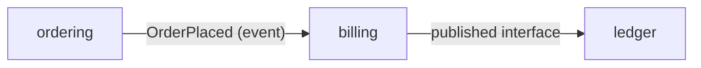
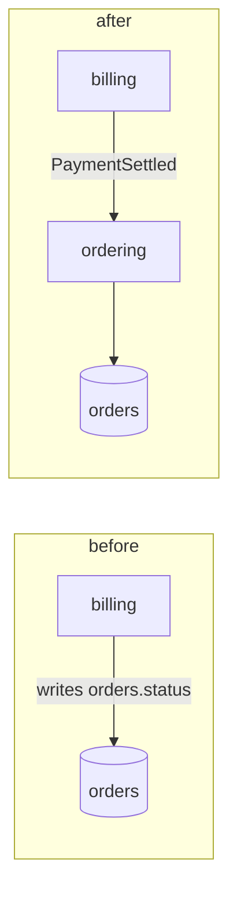

# Document format

Format of `docs/architecture.md`, the output of [arch-audit](SKILL.md). Examples are synthetic.

````md
# Architecture

Audited at <commit>, <date>. Scope of the last run: <area>.

## Design intent

1. <an idea the system is built on, with the decision record that states it>

## Context map



| context | owns | offers | consumes |
|---|---|---|---|
| ordering | orders, order lines | PlaceOrder, CancelOrder; OrderPlaced, OrderCancelled | catalogue interface |

Unowned: `shared/helpers` (see C-007).

## Rules

| rule | held by |
|---|---|
| domain depends on nothing outward | dependency check `<name>`, baseline 3 |
| one context never writes another's data | review only (C-004) |

## Ledger

| id | context | lens | candidate | grade | rank | issue | status |
|---|---|---|---|---|---|---|---|
| C-004 | billing | Reach-in | billing updates order status in place | confirmed | 1 | #210 | fixed in #214 |
| C-007 | shared | Plumbing module | helpers used by 31 modules | judged | 5 | | parked: low change rate |

## ordering

Aggregates: Order (guards: lines non-empty, total matches lines, legal status moves).
Application interface: PlaceOrder, CancelOrder, GetOrder.
Ports: OrderStore, Clock, CatalogueReader. Adapters: store (SQL), catalogue (in-process call).
Events out: OrderPlaced, OrderCancelled. Events in: PaymentSettled.

Lenses: Outward dependency holds: listing clean · Reach-in C-004 · … one entry per lens.

### C-004 billing updates order status in place

Lens: Reach-in. Grade: confirmed.
Evidence: <the command>; 2 write sites to `orders.status` outside ordering (`billing/settle:88`, `billing/refund:41`).
Cost of leaving: the order lifecycle has two owners; both sites changed in 6 of the last 20 changes to ordering.
Deletion test: n/a (leak).
Shapes considered: (a) ordering consumes PaymentSettled and moves its own status, chosen; (b) ordering offers MarkPaid, rejected: billing still decides ordering's lifecycle; (c) shared status service, rejected: a third owner.

Before / after:



Slices: 1. ordering handles PaymentSettled behind the existing behaviour; 2. billing stops writing; 3. check: only ordering writes `orders`.
Held by: data-ownership check, added in slice 3.
````

One section per context, one subsection per candidate. Diagrams show only what the candidate changes.
